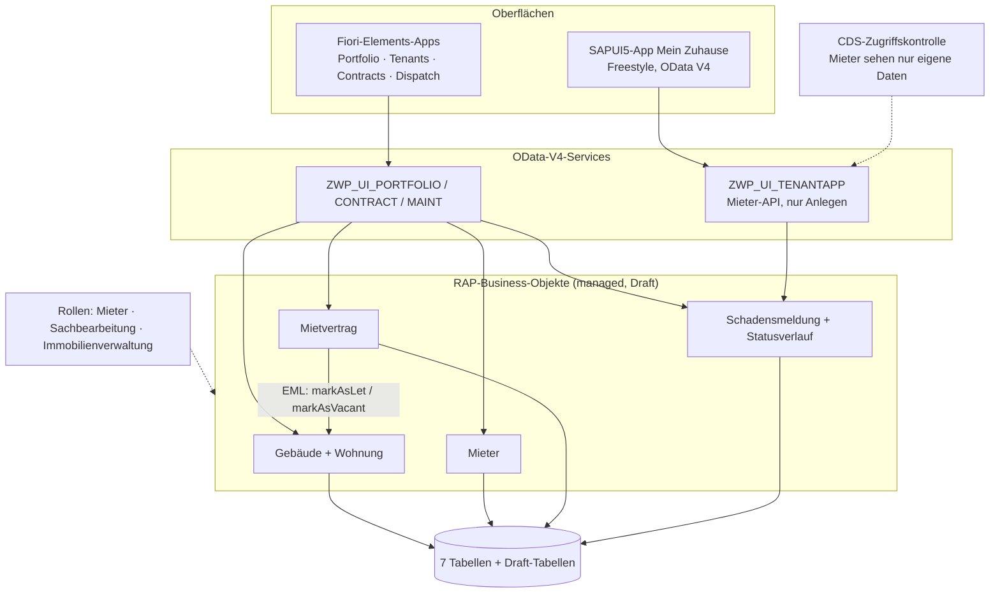

# WohnPortal Mini

*English version: [README.md](README.md)*

Eine kleine Plattform für die Immobilienverwaltung im Stil eines großen deutschen Wohnungsunternehmens: Gebäude, Wohnungen, Mieter, Mietverträge und Schadensmeldungen, die Techniker abarbeiten. Entstanden als Portfolio-Projekt auf der **SAP BTP ABAP Environment** mit **ABAP Cloud, RAP, Fiori Elements und SAPUI5**.

| Backoffice (Fiori Elements) | Mieter-App (SAPUI5) |
|---|---|
|  |  |

## Funktionen

| App | Für | Besonderheiten |
|---|---|---|
| **Portfolio** | Immobilienverwaltung | Gebäude und Wohnungen mit Entwurfsbearbeitung; die Warmmiete rechnet sich schon beim Tippen neu |
| **Tenants** | Sachbearbeitung | Mieterstammdaten mit Prüfung der E-Mail-Adresse |
| **Contracts** | Immobilienverwaltung | Verträge aktivieren und kündigen; beim Aktivieren wird die Wohnung in derselben Transaktion auf *vermietet* gesetzt |
| **Dispatch** | Sachbearbeitung | Schadensmeldungen: Techniker zuweisen, starten, abschließen, ablehnen; SLA-Fälligkeit, überfällige Meldungen rot, vollständiger Statusverlauf |
| **Mein Zuhause** | Mieter | SAPUI5-App fürs Smartphone: meine Wohnung, Schaden melden in einem 3-Schritt-Assistenten, meine Meldungen mit Verlauf; Deutsch und Englisch |

## Architektur



Jedes Business-Objekt folgt denselben Schichten:

```text
Tabelle → CDS-View-Entity (ZWP_R_*) → Behavior-Definition + Klasse (ZBP_*) → Projektion (ZWP_C_*)
        → Metadata Extension (UI-Annotationen) → Service-Definition → Service-Binding (OData V4)
```

## Technische Schwerpunkte

- **Managed RAP-Business-Objekte mit Draft**: Determinations, Validations, Side Effects, Instance Feature Control (Buttons nur, wenn sie Sinn ergeben), Aktionen mit Parameter-Dialogen.
- **BO-übergreifende Transaktion mit EML**: Das Aktivieren eines Vertrags ruft eine Aktion am Gebäude-BO auf; beide werden zusammen gespeichert oder gar nicht.
- **Audit-Trail**: Jede Statusänderung schreibt einen nicht änderbaren Eintrag in den Statusverlauf (Create-by-Association).
- **Berechtigungen in zwei Ebenen**: globale Berechtigung nach Rolle in jedem BO und CDS-Zugriffskontrolle, damit die Mieter-API nur die eigenen Daten liefert. Der Mieter schickt nie mit, wer er ist; das Backend leitet Mieter und Wohnung aus der Anmeldung ab.
- **Geschäftsregeln in einfachen Klassen**: Die SLA-Regel (`ZCL_WP_SLA_CALCULATOR`) hängt nicht von RAP ab und wird für sich getestet.
- **Übersetzbare Meldungen**: Alle 22 Fehlermeldungen liegen in der Nachrichtenklasse `ZWP_MSG` mit Platzhaltern; die deutsche Übersetzung läuft über *Maintain Translations*.
- **Schlanker UI5-Client**: OData-V4-Modell mit `autoExpandSelect`, Batch-Update-Groups, transiente Kontexte für saubere Fehlerbehandlung, i18n für Deutsch und Englisch.

## Qualität

| Prüfung | Umfang | Ergebnis |
|---|---|---|
| ABAP Unit | SLA-Regel (7 Tests), Validierungen, Determinations und Mieterregel der Schadensmeldung (5 Tests) | 12 grün |
| ABAP Test Cockpit | Ganzes Paket, Variante `ABAP_CLOUD_DEVELOPMENT_DEFAULT` | Keine Befunde der Priorität 1/2 |
| QUnit | UI5-Formatter | 5 grün |
| UI5 Linter | Mieter-App | Keine Befunde |

Die Behavior-Tests arbeiten mit EML auf Entwürfen, führen die Aktion `Prepare` aus und rollen zurück, schreiben also nie in die Datenbank. Die Rollentabelle wird durch ein Test-Double ersetzt (`cl_osql_test_environment`).

## Aufbau des Repositorys

```text
src/                   ABAP-Objekte, verwaltet mit abapGit (Paket Z_WOHN_PORTAL)
app/meinzuhause/       SAPUI5-Mieter-App (Projekt aus Business Application Studio)
  webapp/              Views, Controller, Manifest, i18n de/en
  webapp/test/         QUnit-Tests
docs/tenant-api.md     API-Beschreibung des Mieter-Services
```

## Selbst ausprobieren

Benötigt werden ein SAP-BTP-Trial-Konto mit ABAP Environment, Eclipse mit den ABAP Development Tools und SAP Business Application Studio für die UI5-App.

1. **ABAP-Code importieren:** Paket `Z_WOHN_PORTAL` anlegen, dieses Repository mit abapGit verknüpfen (ADT: Sicht *abapGit Repositories* → *Link* → URL dieses Repositorys) und Pull ausführen. Alles aktivieren.
2. **Demodaten:** Klasse `ZCL_WP_DEMO_DATA` ausführen (F9): 5 Gebäude, 40 Wohnungen, 30 Mieter mit Verträgen, 8 Techniker, 60 Meldungen. Der eigene Benutzer wird Mieter T0001.
3. **Rollen:** Klasse `ZCL_WP_ROLE_SETUP` ausführen (F9). Sie gibt dem eigenen Benutzer alle drei Rollen; um nur den Mieter zu spielen, die Liste in der Klasse anpassen.
4. **Backoffice-Apps:** die Service-Bindings `ZWP_UI_PORTFOLIO_O4`, `ZWP_UI_CONTRACT_O4`, `ZWP_UI_MAINT_O4` und `ZWP_UI_TENANTAPP_O4` veröffentlichen und die Fiori-Elements-Vorschau aus dem jeweiligen Binding öffnen.
5. **Mieter-App:** in Business Application Studio dieses Repository klonen, `app/meinzuhause` öffnen, mit dem ABAP-System verbinden (Fiori-Generator, Service `ZWP_UI_TENANTAPP_O4`) und `npm start` ausführen.

## Technologien

SAP BTP ABAP Environment (Trial) · ABAP Cloud · RAP · CDS-View-Entities und Zugriffskontrolle · OData V4 · Fiori Elements · SAPUI5 1.136 · ABAP Unit · ATC · QUnit · abapGit · Eclipse ADT · SAP Business Application Studio

## Autor

Issa Hirwa Nizeyimana · [Linkedin](www.linkedin.com/in/issa-hirwa-nizeyimana-245a393bb)

