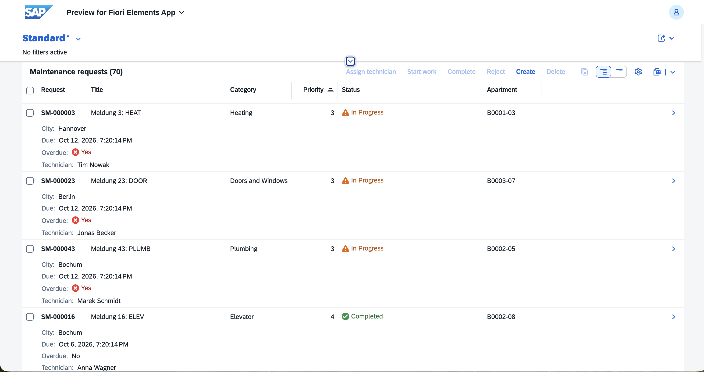
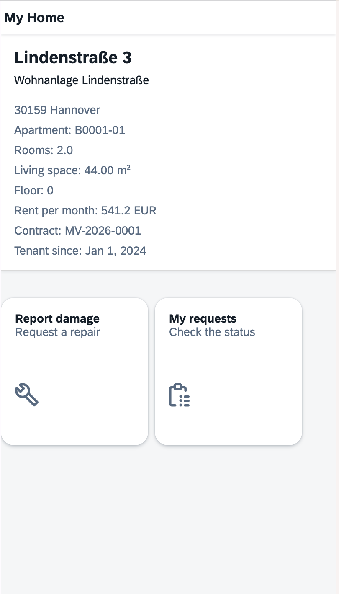
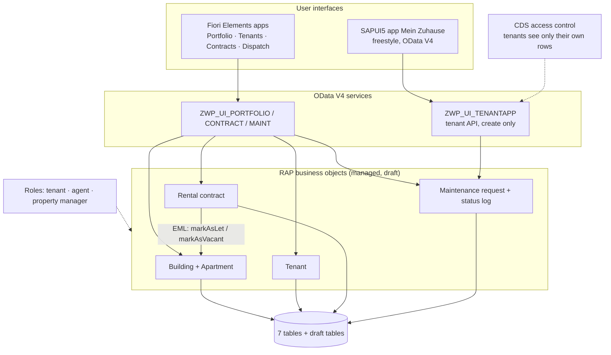

# WohnPortal Mini

*Deutsche Version: [README.de.md](README.de.md)*

A small property-management platform in the style of a large German housing company: buildings, apartments, tenants, rental contracts, and maintenance requests that technicians work through. Built as a portfolio project on **SAP BTP ABAP Environment** with **ABAP Cloud, RAP, Fiori Elements and SAPUI5**.

| Back office (Fiori Elements) | Tenant app (SAPUI5) |
|---|---|
|  |  |

## What it does

| App | For | Highlights |
|---|---|---|
| **Portfolio** | Property managers | Buildings and apartments with draft editing; warm rent recalculates live while typing |
| **Tenants** | Agents | Tenant master data with e-mail validation |
| **Contracts** | Property managers | Activate and terminate contracts; activating sets the apartment to *let* in the same transaction |
| **Dispatch** | Agents | Maintenance requests: assign a technician, start, complete, reject; SLA due dates, overdue requests in red, full status history |
| **Mein Zuhause** | Tenants | Phone-first SAPUI5 app: my home, report damage in a 3-step wizard, my requests with status history; German and English |

## Architecture



Each business object follows the same layers:

```text
Table → CDS view entity (ZWP_R_*) → behavior definition + class (ZBP_*) → projection (ZWP_C_*)
      → metadata extension (UI annotations) → service definition → service binding (OData V4)
```

## Technical highlights

- **RAP managed business objects with draft**: determinations, validations, side effects, instance feature control (buttons only when they make sense), actions with parameter dialogs.
- **Cross-BO transaction via EML**: activating a contract calls an action on the Building BO; both are saved together or not at all.
- **Audit trail**: every status change writes a read-only status log entry (create-by-association).
- **Authorization in two layers**: global authorization by role in every BO, and CDS access control so the tenant API only ever returns the tenant's own data. The tenant never sends who they are; the backend derives tenant and apartment from the login.
- **Business rules in plain classes**: the SLA rule (`ZCL_WP_SLA_CALCULATOR`) has no RAP dependency and is unit-tested on its own.
- **Translatable messages**: all 22 error messages live in message class `ZWP_MSG` with placeholders; German translation via *Maintain Translations*.
- **Thin UI5 client**: OData V4 model with `autoExpandSelect`, batch update groups, transient contexts for clean error handling, i18n for German and English.

## Quality

| Check | Scope | Result |
|---|---|---|
| ABAP Unit | SLA rule (7 tests), maintenance request validations, determinations and tenant rule (5 tests) | 12 green |
| ABAP Test Cockpit | Whole package, variant `ABAP_CLOUD_DEVELOPMENT_DEFAULT` | No priority 1/2 findings |
| QUnit | UI5 formatter | 5 green |
| UI5 linter | Tenant app | No findings |

The behavior tests use EML on drafts, run the `Prepare` action and roll back, so they never write to the database. The role table is replaced by a test double (`cl_osql_test_environment`).

## Repository structure

```text
src/                   ABAP objects, managed by abapGit (package Z_WOHN_PORTAL)
app/meinzuhause/       SAPUI5 tenant app (Business Application Studio project)
  webapp/              views, controllers, manifest, i18n de/en
  webapp/test/         QUnit tests
docs/tenant-api.md     API description of the tenant service
```

## Running it yourself

You need an SAP BTP trial account with the ABAP environment, Eclipse with ABAP Development Tools, and SAP Business Application Studio for the UI5 app.

1. **Import the ABAP code:** create the package `Z_WOHN_PORTAL`, then link this repository with abapGit (ADT: *abapGit Repositories* view → *Link* → this repository's URL) and pull. Activate everything.
2. **Demo data:** run class `ZCL_WP_DEMO_DATA` (F9): 5 buildings, 40 apartments, 30 tenants with contracts, 8 technicians, 60 requests. Your user becomes tenant T0001.
3. **Roles:** run class `ZCL_WP_ROLE_SETUP` (F9). It gives your user all three roles; edit the list inside to play only the tenant.
4. **Back-office apps:** publish the service bindings `ZWP_UI_PORTFOLIO_O4`, `ZWP_UI_CONTRACT_O4`, `ZWP_UI_MAINT_O4` and `ZWP_UI_TENANTAPP_O4`, then open the Fiori Elements preview from each binding.
5. **Tenant app:** in Business Application Studio, clone this repository, open `app/meinzuhause`, connect it to your ABAP system (Fiori generator, service `ZWP_UI_TENANTAPP_O4`) and run `npm start`.

## Built with

SAP BTP ABAP Environment (trial) · ABAP Cloud · RAP · CDS view entities and access control · OData V4 · Fiori Elements · SAPUI5 1.136 · ABAP Unit · ATC · QUnit · abapGit · Eclipse ADT · SAP Business Application Studio

## Author

Issa Hirwa Nizeyimana · [Linkedin](www.linkedin.com/in/issa-hirwa-nizeyimana-245a393bb)

